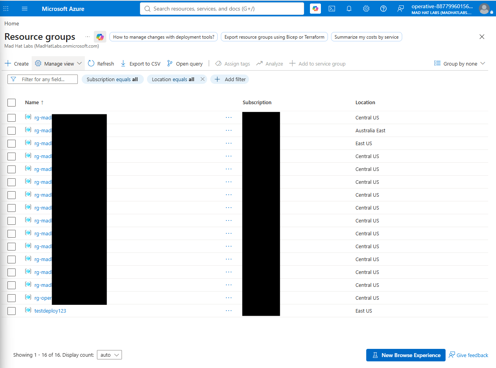
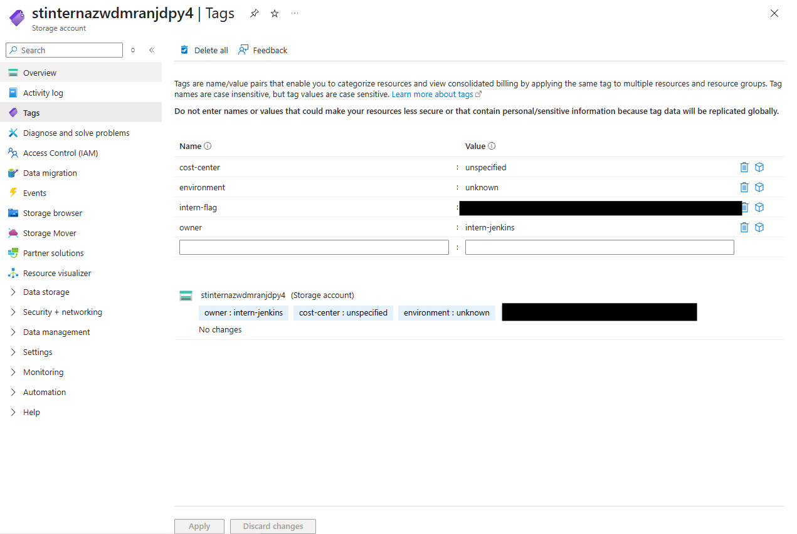
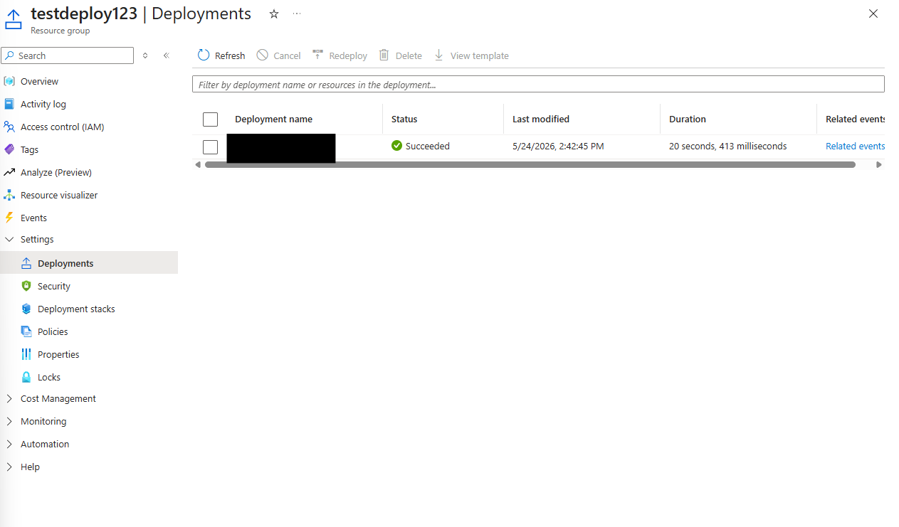
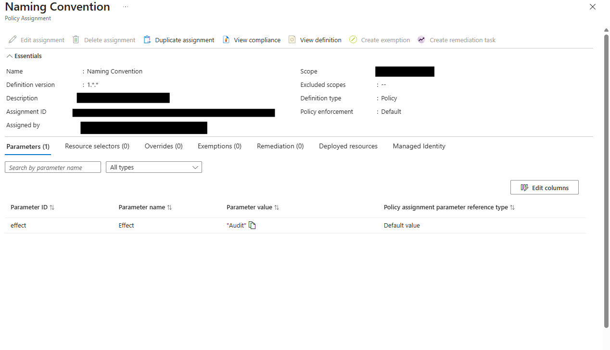

# [ OPERATION DEAD DEPLOY]

## Scenario

Two days ago, a junior intern at Mad Hat Labs was given temporary contributor access to spin up a "test environment" for an experiment that would not be presented to leadership. The intern was not familiar with the company's governance standards and they cut several corners. They deployed quickly and left for the weekend. I guess they didn't get the no-change Friday memo. You are the on-call Azure engineer who came in Monday morning and found this in the subscription. Your job is to assess the damage, identify what governance failed, and document the evidence. You have Reader access to everything the intern touched. Use the Azure portal and lessons from this chapter. Don't try to break anything as we're in observe mode.

## Environment

Azure, Resource groups, Tags, Policy

## Investigation

Step 1. Examing what went wrong after the intern deployment. When looking throught he deployed reasource group i noticed one out of alignment with our policies. I flagged the out of bounds resource group for further investigation.

Step 2. Clicking into the RG i noticed that there was a asset created. I went to look to see if there were any tags created examining it I noticed the Intern atleast did some tagging so I was able to get some information from those.

Step 3. With the initial information gathered, I needed to determine when the resource was deployed. I navigated to the Deployments tab, located the initial deployment record, and reviewed its timestamp to establish the deployment timeline.

Step 4. After establishing the who and the what, I investigated why the resource was allowed to be created despite violating our naming policy. I found that the policy was configured with the Audit effect rather than Deny. This meant the policy flagged noncompliant resources but did not block their creation, explaining how the deployment was allowed to proceed.

## What broke / what surprised me

What surprised me was that the naming policy was configured to audit violations rather than prevent them. The policy appeared to be working as configured, but its configuration left a gap in enforcement. The intern was able to deploy a noncompliant resource without an apparent review or approval from a supervisor.

## Findings and recommendations

Enforce naming requirements: Change the naming policy’s effect from Audit to Deny to block noncompliant deployments, particularly in production. Review existing resources and test the change before enforcement.

Restrict Contributor access: Review role assignments and apply least privilege, granting deployment permissions only to users who need them and at the appropriate scope.

Require resource tags: Enforce mandatory tags, such as owner, environment, and cost center, for supported resource types to improve accountability and tracking.

## What I learned

I learned to verify that policies intended to block noncompliant deployments use Deny, especially in production. Audit is useful for assessing compliance and testing policies before enforcement, but it does not prevent violations.

I surprised myself with how quickly I navigated the resource group and located the information needed for my investigation.

This lab reinforced the importance of least privilege and carefully reviewing who receives elevated permissions, what they can access, and why they need that access.
