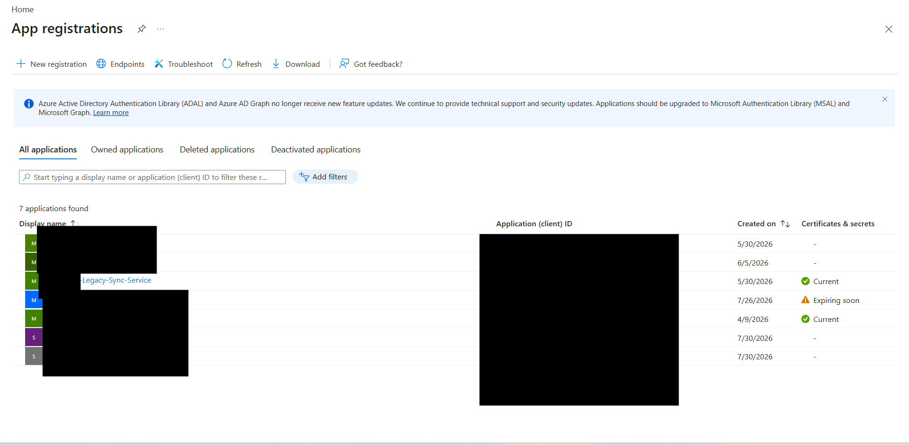
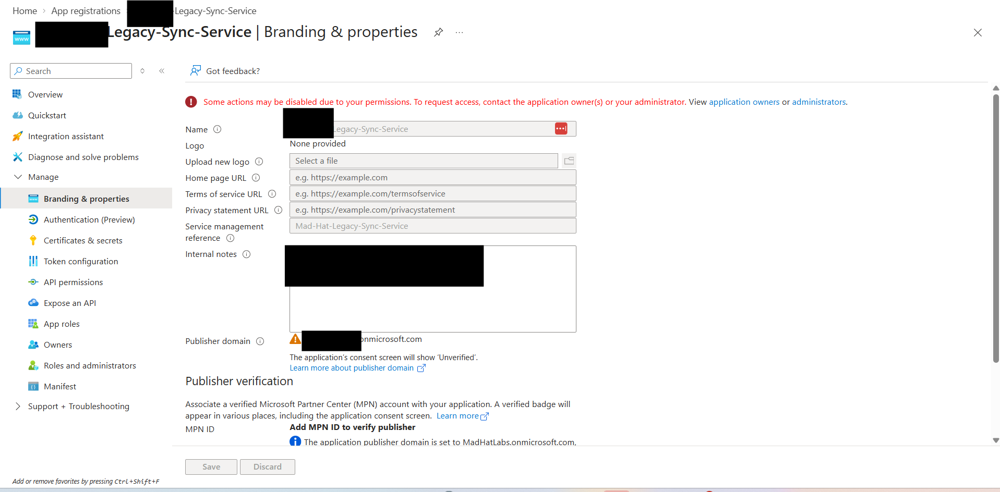
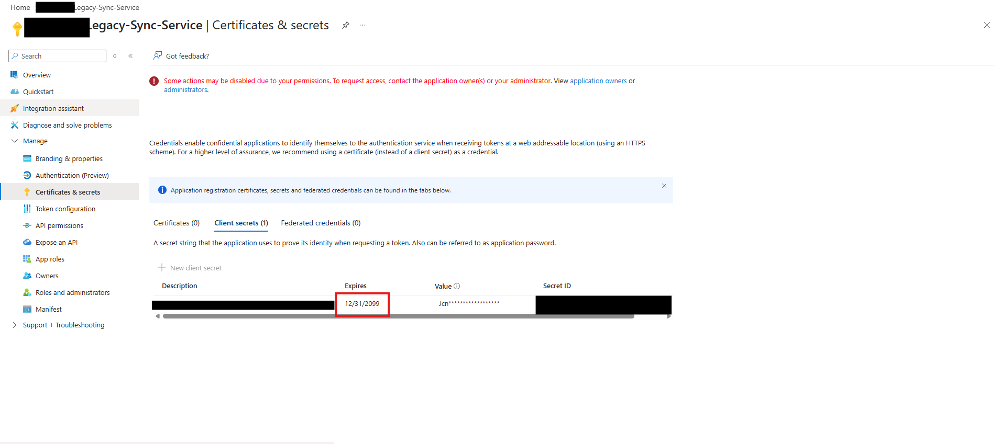
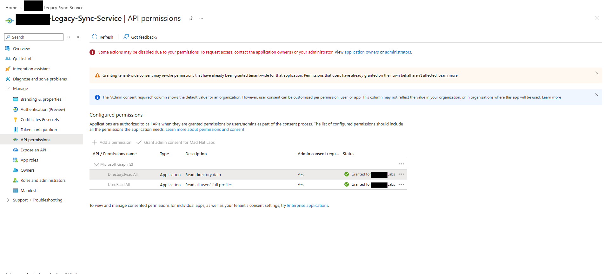
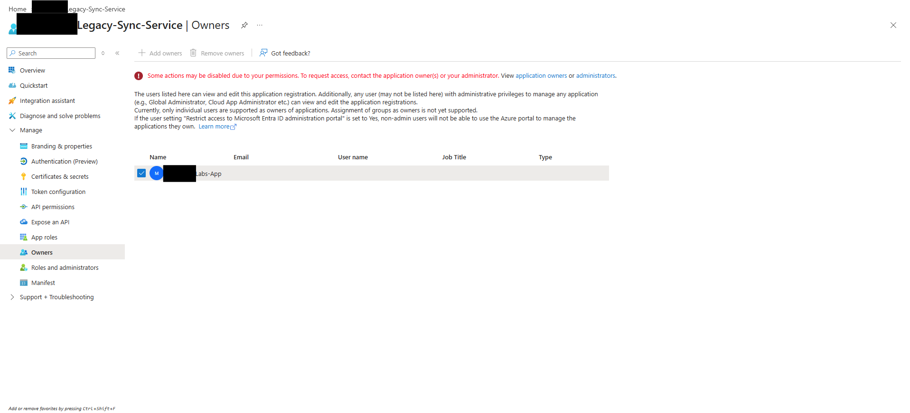
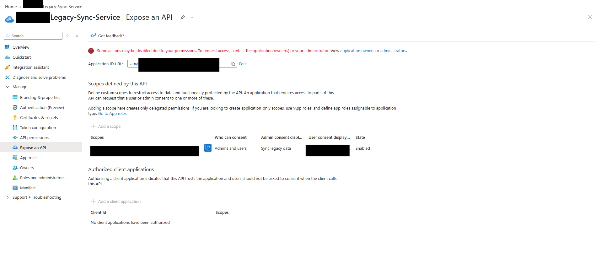
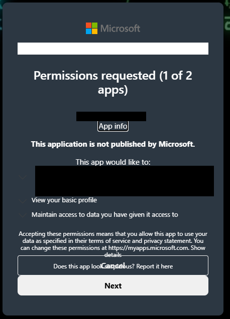
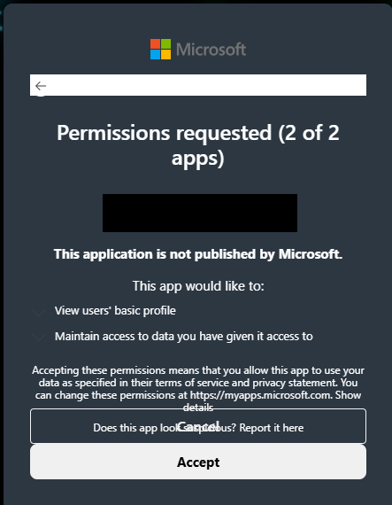

# The Stolen Identity

## Scenario

Reconstructed a five-stage OAuth consent-phishing kill chain in a live Azure tenant through forensic analysis of two linked app registrations.

## Environment

Platform: Microsoft Azure
Services and components: Microsoft Entra ID, app registrations, enterprise applications, and API permissions
Environment: Live, multi-user Azure training tenant
Investigation status: Active
Assigned access: Operative — Reader access

## Investigation

<ol>
<li>ENTRY — Initial Compromise

An end user reportedly fell victim to a phishing email and completed an MFA prompt through a fraudulent sign-in page. The attacker then captured the user’s session token, which carried a claim indicating that MFA had already been satisfied.

During my investigation, I identified an association between the compromised user and a legacy application named XX-Legacy-Sync-Service.</li>

The incident team logged the entry method as metadata on the legacy app.

<li>ESCALATE — Compromise of the Application Identity

The next step in my investigation was to review the compromised user’s access and determine the potential blast radius. Broken access controls allowed the attacker to create a new client secret for XX-Legacy-Sync-Service.

Using this secret, the attacker could authenticate as the application’s service principal and exercise its existing application permissions in the directory without further user interaction. This expanded the compromise from the user’s session to the legacy application’s identity.

My investigation led me to the Certificates & secrets section of XX-Legacy-Sync-Service, where I identified a certificate configured to expire in 2099. This unusually long validity period suggested a potential persistence mechanism, allowing continued authentication as the application if an attacker controlled the corresponding private key.

Further investigation would be needed to confirm who added the certificate and whether it had been used by the attacker. </li>

<li>PIVOT. I expanded my investigation to determine whether the attacker had created additional applications to maintain access. In the Owners list of XX-Legacy-Sync-Service, I identified the service principal of XX-Labs-App, the attacker’s newly registered application.

This ownership relationship provided a potential persistence path beyond the original compromised credential. I also reviewed the legacy application’s API permissions, where Microsoft Graph application permissions had been granted admin consent, establishing the application’s potential reach within the tenant.

</li>

<li>I reviewed the Expose an API configuration of XX-Legacy-Sync-Service and identified an unauthorized custom scope under Scopes defined by this API. Its User consent display name contained the next flag.

In this scenario, the attacker used the compromised user’s excessive permissions to add the scope as a foundation for a future consent-phishing campaign involving XX-Labs-App. Rotating the legacy application’s credentials alone would leave this configuration in place.</li>

<li>LOOT. The attacker constructed an authorization link using XX-Labs-App, an attacker-controlled redirect URI, and the custom Legacy.Sync scope exposed by XX-Legacy-Sync-Service.

If a signed-in user followed the link and approved the requested permissions, the authorization flow could return an authorization code to the attacker-controlled redirect URI. The rogue application could then exchange that code for an access token and attempt to call the legacy API within the granted scope and the API’s authorization controls.

This stage relied on obtaining consent through a legitimate Microsoft authorization page. An existing authenticated session could allow the user to proceed without another MFA prompt, depending on applicable policies.</li>

 

</ol>
## What broke / what surprised me

The most credible section in the document. Dead ends, wrong guesses, the thing that took an hour. Employers know real work is messy. This section separates you from certificate collectors.

## Findings and recommendations

Findings and Recommendations

My investigation determined that the compromised identity’s excessive access enabled the attacker to extend control into XX-Legacy-Sync-Service. Findings included an added client secret, a rogue application’s service principal assigned as an owner, and an unauthorized API scope. A certificate valid until 2099 also warranted investigation as a potential persistence mechanism. Together, these findings indicated that credential rotation alone would not fully address the compromise.

I recommend the resource owner:

Remove unauthorized access and persistence. Preserve evidence, remove attacker-added credentials and ownership assignments, and remove the unauthorized scope and any associated consent grants. Investigate the long-lived certificate and disable the rogue application.

Reduce excessive permissions. Review application owners, directory roles, and consented API permissions. Retain only the access required for the service’s documented business purpose.

Improve detection and authentication controls. Alert on application registrations, credential additions, ownership changes, and consent grants. Enforce phishing-resistant MFA for users and restrict user consent to reduce opportunities for future compromise.

## What I learned

1. Technical Excessive permissions can expand a compromise.
   I learned how a compromised user’s access can allow an attacker to add application credentials, assign owners, and establish additional access paths. I also saw why certificate expiration dates matter: a certificate valid until 2099 could support long-term persistence if the attacker controls its private key.

2. Investigative Follow the relationships between identities.
   I learned to investigate beyond the compromised account. Reviewing app registrations, service principals, ownership, API permissions, and exposed scopes helped me understand how the attacker connected a rogue application to a trusted legacy service.

3. Defensive Credential rotation alone is not complete remediation.
   I learned that changing passwords and removing secrets can leave attacker-created ownership assignments and API scopes behind. I also learned the distinction between a fake MFA page that captures a session and consent phishing that tricks a user into authorizing a rogue application.
